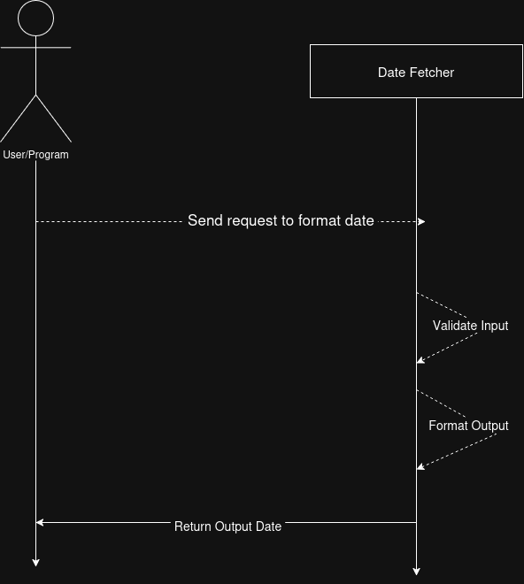

# Date Fetcher Microservice

## Description

This program is designed to run alongside other programs. when called, date_fetch
will take an input date and output the same date in the desired format.

## Installation

Navigate into the directory containing date_fecth.py and execute the following:

~~~text
python -m venv .venv
.\.venv\Scripts\Activate.ps1
python -m pip install -r requirements.txt
~~~

## Setup and Sending Requests

~~~python
import multiprocessing as mp
import subprocess as sp
import json
import zmq

#Setup socket, other data
context = zmq.Context()

socket = context.socket(zmq.REQ)
socket.connect("tcp://localhost:5561")

#run datefetch as subprocess
def run_df():
    sp.run(["python3", "./date_fetch.py"])

df = mp.Process(target=run_df)
df.start()

~~~

Date_fetch takes as input a JSON object sent across socket 5561.
Properly formatted input contains three keys:

~~~json

{
    "date": "date_to_format",
    "input_format": "format_of_given_date",\
    "output_format": "format_to_return_with"
}

~~~

Input and output formats can be any string you want, so long as input
format matches the format of the input date.

### Parameter Requirements

Input and output format parameters have the same options to choose
from, as demonstrated below:

|Symbol|Meaning|Example|
|---|---|---|
|%Y|4-digit year|2026|
|%y|2-digit year|26|
|%m|Month as a 2-digit number|11|
|%B|Full month name in writing|November|
|%b|Abbreviated month name|Nov|
|%d|Day of the month (01-31)|10|
|%A|Full weekday name|Tuesday|
|%a|Abbreviated weekday name|Tue|
|%j|Day of the year (001-366)|314|

### Example Client Call

~~~python
request = {
    "date": "11/10/2026",
    "input_format": "%m/%d/%Y",
    "output_format": "%A, %B %d, %Y"
}

socket.send_json(request)
response = socket.recv_json()
~~~

### Example output JSON returned to client

~~~json
{
   "success": true,
   "output_date": "Tuesday, November 10, 2026"
}
~~~

### Example output for a failed response

~~~json
{
    "success": false,
    "error": "error_msg"
}
~~~

### IMPORTANT: Ending microservice

Date_fetch is designed to wait continuously for new input until
told to end.
To end date_fetch, send the following:

~~~python
request = {
    "end": True
}
socket.send_json(request)

df.join()
~~~

This will prevent date_fetch from continuing to run when not wanted.

## UML Diagram

